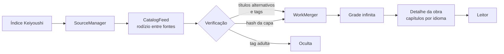

<div align="center">


# MangaCademy

**Um leitor de mangá, manhwa e manhua nativo para iOS que reúne centenas de fontes em um único catálogo.**

[](#requisitos)
[](https://www.swift.org)
[](https://developer.apple.com/xcode/swiftui/)
[](https://developer.apple.com/xcode/swiftdata/)
[](#fontes)

[Recursos](#recursos) •
[Fontes](#fontes) •
[Como funciona](#como-funciona) •
[Instalação](#instalação) •
[Arquitetura](#arquitetura) •
[Aviso legal](#aviso-legal)

</div>

---

## Sobre

O MangaCademy transforma as extensões do repositório [**Keiyoushi**](https://github.com/keiyoushi/extensions) em um catálogo único e infinito no iPhone. A mesma obra publicada por dezenas de sites, em vários idiomas, aparece **uma única vez**, com todos os capítulos unificados e separados por idioma.

Como as extensões originais são APKs Android, o app reimplementa em Swift os temas e APIs usados por elas. Nada é executado a partir de código de terceiros: tudo roda nativamente.

## Recursos

- **Catálogo infinito** — consulta todas as fontes em rodízio e continua carregando até a última página da última fonte.
- **Unificação inteligente de obras** — a mesma obra em fontes e idiomas diferentes vira um único card, reconhecida por:
  - títulos e títulos alternativos idênticos;
  - títulos traduzidos com o mesmo significado (_“Ilusão de Amor: Superstar”_ = _“Love is an Illusion! - Superstar”_ = _“El amor es una ilusión Superstar”_);
  - impressão digital da capa (dHash), que reconhece a mesma arte mesmo redimensionada.
- **Todos os idiomas no Explorar** — o catálogo mostra obras de todas as fontes, em qualquer idioma. O idioma preferido (Ajustes) define quais capítulos aparecem primeiro.
- **Recentes de verdade** — a aba Recentes ordena as obras pelo capítulo mais novo de todas as fontes, com a legenda _“Cap. 123 · há 2 h”_.
- **Filtro por tags** — Romance, Escolar, Ficção científica… no Explorar e na Biblioteca. Sinônimos em vários idiomas viram a mesma tag (_School Life_ = _Vida Escolar_ = _Escolar_), e a obra precisa ter todas as tags marcadas.
- **Capítulos sem repetição** — capítulos de várias scans são mesclados e deduplicados por número.
- **Bloqueio de conteúdo adulto** — esconde obras com as tags _Adult_, _Adulto_ ou _+18_ (ligado por padrão, ajustável em Ajustes). Tags como _Vida Adulta_ não são afetadas.
- **Leitor Webtoon e paginado**, com progresso, histórico e biblioteca salvos localmente.
- **Marcar todos / desmarcar todos** — acima da lista de capítulos, com confirmação; vale também para obras fora da biblioteca.
- **Virar página com os botões de volume** — Volume − avança e Volume + volta (inversível em Ajustes). No fim do capítulo, um segundo clique abre o próximo.
- **Cache em disco** de capas e metadados, para abrir o catálogo de novo sem refazer o trabalho.
- **Fontes resilientes** — sites fora do ar ou atrás de proteção anti-bot são consultados por último e não travam o restante.

## Fontes

O índice de extensões vem do repositório [keiyoushi/extensions](https://github.com/keiyoushi/extensions) e é atualizado dentro do app (Ajustes → Atualizar índice do repositório). Das 2.344 fontes do índice, **670** usam um motor que o app implementa:

| Motor | Tipo | Exemplos |
| --- | --- | --- |
| **Madara** | Tema WordPress | Centenas de scans em PT, EN, ES e outros idiomas |
| **MangaThemesia** | Tema WordPress | Tsundoku Traduções e similares |
| **ZeistManga** | Tema Blogger | Ler 999 e similares |
| **Keyoapp** e **Keyoapp V2** | Tema | Mist Scans, Luna Toons e similares |
| **Iken** | API JSON | Ken Scans e similares |
| **MangaCatalog** | Tema | Sites de uma franquia só (Read Berserk, Read One Piece…) |
| **YiiManga** | Tema | ManhwaBuddy, LeerManhwas e similares |
| **MangaHub** | API GraphQL | Rede MangaHub (MangaFox.fun, MangaHere.onl…) |
| **PizzaReader** | API JSON | Scans italianas e francesas (FMTEAM, Hasta Team…) |
| **FoolSlide** | Leitor | Scans antigas em EN, ES e IT (NIFTeam, Menudo-Fansub…) |
| **Guya** | API JSON | Guya, Danke fürs Lesen e similares |
| **MMRCMS** | Tema | Scan VF, AnzManga e similares |
| **MangaDex** | API oficial | Multi-idioma |
| **NamiComi**, **GlobalComix**, **MangaBall** | API | Multi-idioma (uma fonte por idioma) |
| **Webtoons** | HTML + API | Multi-idioma |
| **ComicFury** | HTML | Webcomics independentes, multi-idioma |
| **ComicK** | API | Multi-idioma |
| **NexusToons** | API cifrada | Português |
| **Weeb Central** | HTML (HTMX) | Inglês |

> [!NOTE]
> Sites protegidos por Cloudflare ou bloqueados pela sua rede/DNS podem não responder. O app segue funcionando com as demais fontes.

As outras extensões têm código próprio para cada site (ou usam temas ainda não portados) e ficam de fora até ganharem um motor. Para gerar o catálogo de novo e conferir quais fontes estão respondendo:

```bash
python3 tools/build_keiyoushi_catalog.py   # atualiza Resources/keiyoushi_catalog.json
python3 tools/check_sources.py --out saude.md   # ok, Cloudflare, fora do ar, HTML mudou
```

## Como funciona



1. **Coleta** — o `CatalogFeed` pede páginas a cada fonte em rodízio, conforme a rolagem.
2. **Verificação** — antes de aparecer, cada obra nova recebe títulos alternativos, tags e a impressão digital da capa (com cache de 14 dias).
3. **Unificação** — o `WorkMerger` decide se a obra é nova ou se pertence a uma obra existente.
4. **Leitura** — o detalhe carrega todas as fontes da obra, agrupa os capítulos por idioma e remove duplicatas.

## Instalação

### Requisitos

- macOS com **Xcode 16** ou superior
- iPhone ou simulador com **iOS 17** ou superior

### Compilando

```bash
git clone https://github.com/Lucaddias/MangaCademy.git
cd MangaCademy
open MangaCademy.xcodeproj
```

No Xcode, escolha seu time em **Signing & Capabilities**, selecione o dispositivo e pressione <kbd>⌘</kbd> + <kbd>R</kbd>.

## Arquitetura

```
Sources/
├── App/          # Ponto de entrada e navegação por abas
├── Core/         # Catálogo, unificação, filtros, HTTP e parser HTML (libxml2)
├── Models/       # Modelos de fonte e de domínio (SwiftData)
├── Services/     # Índice Keiyoushi e cache de imagens
├── Sources/      # Implementações das fontes
│   └── Engines/  # Temas reutilizáveis (Madara, MangaThemesia, Iken, YiiManga…)
└── Views/        # Explorar, Biblioteca, Histórico, Detalhe, Leitor e Ajustes
```

| Componente | Responsabilidade |
| --- | --- |
| `CatalogFeed` | Paginação infinita, concorrência e verificação antes de exibir |
| `WorkMerger` | Unificação por título, conceitos traduzidos e capa |
| `TitleConcepts` | Normaliza títulos PT/ES/FR para conceitos em inglês |
| `CoverFingerprint` | dHash de 64 bits das capas |
| `ContentFilter` | Regras do bloqueio de tags adultas |
| `GenreTags` | Junta sinônimos de tags em vários idiomas para o filtro por tags |
| `ChapterDateParser` | Datas de capítulo relativas e absolutas em vários idiomas |
| `SourceAggregator` | Agrupa e deduplica capítulos por idioma |

## Contribuindo

Contribuições são bem-vindas! Abra uma _issue_ para relatar fontes quebradas ou obras unificadas incorretamente, ou envie um _pull request_.

1. Faça um fork do projeto
2. Crie sua branch (`git checkout -b feature/minha-fonte`)
3. Faça commit das mudanças (`git commit -m 'Adiciona fonte X'`)
4. Envie (`git push origin feature/minha-fonte`) e abra um pull request

## Aviso legal

O MangaCademy **não hospeda nenhum conteúdo**. Ele apenas exibe material disponibilizado publicamente por sites de terceiros, da mesma forma que um navegador. Os direitos das obras pertencem aos seus autores e editoras — apoie os lançamentos oficiais sempre que possível.

## Agradecimentos

- [Keiyoushi](https://github.com/keiyoushi/extensions) — pelo índice de extensões e pela documentação das fontes
- A todas as scans e tradutores que mantêm as obras acessíveis

<div align="center">

Feito com ☕ e SwiftUI por [Lucaddias](https://github.com/Lucaddias)

</div>
